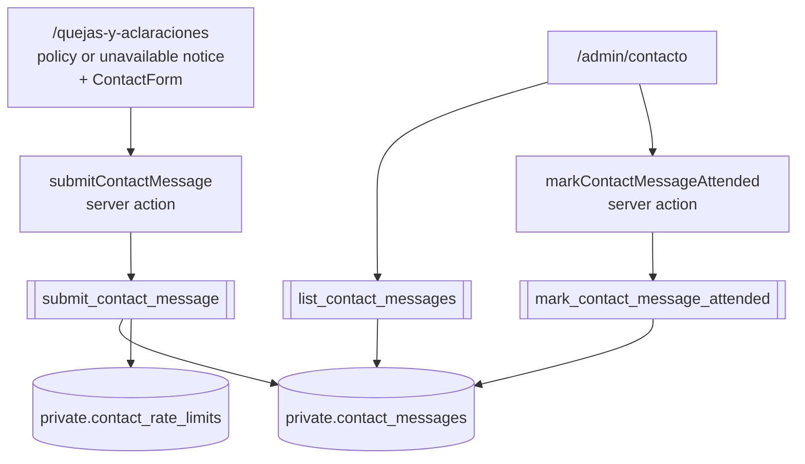

# Contact Form on Quejas y Aclaraciones — Design Specification

## Objective

Give anyone a way to write to Plaza Volcanes from `/quejas-y-aclaraciones`, today, without waiting for the complaints policy to be drafted, approved and published. A visitor leaves a name, an email, a phone number and a message. A signed-in person writes only the message: the account already says who they are.

## Scope

This project includes:

- A form on `/quejas-y-aclaraciones`, below the policy or below the notice that says the policy is not published yet
- Storage for what is sent, reachable only through database functions
- A limit on how much can be sent per hour, and a honeypot against simple bots
- `/admin/contacto`: what has arrived, newest first, with who sent it and how to reach them, and a way to mark a message as attended
- Database, validation, action, mapper, component, page and end-to-end tests

This project excludes:

- Answering from the admin page. Administration answers by email or phone.
- Email alerts on arrival. No email provider is wired for this; `private.notification_outbox` is the place for it later.
- Attachments, categories, case reference numbers, and a status beyond new and attended. The `support_cases` design in `2026-08-26-legal-privacy-consent-design.md` §4.5 remains the plan for a full complaints workflow; this table can feed it.
- A sender's own history of what they sent.
- Any change to the legal document system. The form does not depend on a published `complaints_policy`.

## How it fits together

The table lives in `private`, like `private.platform_notice_batches`: no browser role reads or writes it. The three functions are the whole surface.

## Data

### `private.contact_messages`

| Column | Type | Notes |
| --- | --- | --- |
| `id` | `uuid` primary key | `gen_random_uuid()` |
| `user_id` | `uuid` null | `auth.users (id) on delete set null`. Set for a signed-in sender. |
| `name` | `text` null | 2–120 characters |
| `email` | `text` null | up to 254 characters, contains `@` |
| `phone` | `text` null | `^\+52[0-9]{10}$`, the form `user_contact_details.phone` already uses |
| `message` | `text` not null | 10–2000 characters, trimmed |
| `created_at` | `timestamptz` | `now()` |
| `attended_at` | `timestamptz` null | |
| `attended_by` | `uuid` null | `auth.users (id) on delete set null` |

A signed-in sender's row carries a snapshot of their name, email and phone taken when they wrote, so the message still says who to answer after the account is deleted. The check is therefore simple: `email` is never null, and a row without `user_id` also has `name` and `phone`.

A signed-in sender may have no phone on file and no display name; those two stay null for them.

Row-level security is enabled with no policies, and every privilege is revoked from `public`, `anon` and `authenticated`.

### `private.contact_rate_limits`

Hourly buckets, the shape `private.message_rate_limits` already uses.

| Column | Type | Notes |
| --- | --- | --- |
| `sender` | `text` | the account id as text, or `'anon'` |
| `window_hour` | `timestamptz` | `date_trunc('hour', now())` |
| `sent_count` | `integer` | |

Primary key `(sender, window_hour)`. A signed-in person may send 5 an hour. Everyone who is signed out shares one bucket of 30 an hour: the database sees no address for them, and a shared cap is what keeps the table from being filled. Buckets older than 24 hours are removed on each accepted send.

### Functions

**`public.submit_contact_message(p_message text, p_name text, p_email text, p_phone text) returns uuid`** — security definer, granted to `anon` and `authenticated`.

- Trims the message; refuses anything outside 10–2000 characters (`22023`).
- Signed in (`auth.uid()` is not null): ignores the three contact parameters and takes the email from `auth.users`, the name from `public.user_display_names`, the phone from `public.user_contact_details`.
- Signed out: requires a name of 2–120 characters, an email with an `@` of at most 254 characters, and a phone matching `^\+52[0-9]{10}$` (`22023` otherwise).
- Counts against the rate limit; over it raises `P0001` with `Recibimos demasiados mensajes. Intenta de nuevo en un rato.`
- Inserts and returns the new id.

**`public.list_contact_messages()`** — security definer, granted to `authenticated`, raises `42501` unless the caller is in `private.admin_users`. Returns `id, has_account, name, email, phone, message, created_at, attended_at`, unattended first, then newest first, 200 at most. `has_account` is true while the row still points at an account.

**`public.mark_contact_message_attended(p_message_id uuid) returns void`** — same guard. Stamps `attended_at` and `attended_by` on a row not yet attended; `P0002` when the id matches nothing; a second call changes nothing.

No audit event: marking a message attended takes nothing from anyone, and the row itself records who did it and when.

## Server

**`lib/validation/contact-message.ts`** — two zod schemas. `contactMessageSchema` is the message alone: trimmed, 10–2000 characters. `visitorContactMessageSchema` adds `name` (trimmed, 2–120), `email` (`z.email`, trimmed) and `phone` (the existing `mexicanMobileSchema`, which returns E.164).

**`lib/actions/contact.ts`**

- `submitContactMessage(previous, formData)`:
  1. A filled honeypot field (`website`) answers with the ordinary success message and stores nothing.
  2. Reads the session. Signed in → validates the message only. Signed out → validates all four fields. The first problem comes back as `message`, with per-field `errors`.
  3. Calls `submit_contact_message`. `P0001` → the rate-limit sentence. Anything else → `No pudimos enviar tu mensaje. Intenta de nuevo.`
  4. Success → `Recibimos tu mensaje. Te responderemos por correo o teléfono.` and `revalidatePath("/admin/contacto")`.
- `markContactMessageAttended(previous, formData)`: the administrator check `platform-notices.ts` uses, then the function, then revalidates `/admin/contacto`.

**`lib/queries/contact.ts`** maps a row to `ContactMessage`; **`lib/queries/contact.server.ts`** holds `listContactMessages()`, which reads as empty on an error.

**`lib/database.types.ts`** gains the three functions.

## Interface

**`components/legal/contact-form.tsx`** — client component, `useFormAction`. One prop, `signedIn`.

- Signed out: `Nombre`, `Correo electrónico`, `Teléfono móvil`, `Mensaje`, all required.
- Signed in: `Mensaje` only, and a line saying the answer goes to the contact details of the account.
- Rejected sends give back what was typed, as every other form here does. A field error is tied to its field with `aria-describedby`; the summary uses `role="status"`.
- After a successful send the form is replaced by the confirmation and a button to write another message.
- The honeypot is a text field outside the tab order, hidden from assistive technology and from view.
- Below the button, one line: `Usamos estos datos solo para responder tu mensaje.` with a link to `/privacidad`. It states what the code does and nothing more. Counsel's simplified notice (LFPDPPP art. 16) replaces it when the privacy notice is published.

**`app/(legal)/quejas-y-aclaraciones/page.tsx`** renders `LegalRoutePage` and then a section headed `Escríbenos`, within the same reading width. It asks the session whether someone is signed in. The form is there whether or not the policy is published.

**`/admin/contacto`** — `requireAdmin`, heading `Contacto`, one card per message: who (name, or `Sin nombre`), email as a `mailto:` link, phone as a `tel:` link when there is one, whether they wrote from an account, when, the message with its line breaks kept, and either `Marcar como atendido` or `Atendido`. An empty list says so. `app/admin/layout.tsx` gains a `Contacto` link.

## Errors

| Case | What the person sees |
| --- | --- |
| Message too short or too long | `Escribe un mensaje de entre 10 y 2000 caracteres.` |
| Missing or malformed name, email, phone | the message for that field, under that field |
| Over the hourly limit | `Recibimos demasiados mensajes. Intenta de nuevo en un rato.` |
| Supabase not configured, or any other failure | `No pudimos enviar tu mensaje. Intenta de nuevo.` |
| Not an administrator on the admin action | `No tienes permiso para atender mensajes.` |

## Testing

- **pgTAP** `contact_messages.test.sql`: function signatures and grants; no table privilege for `anon` or `authenticated`; a signed-out send stores what was typed; a signed-out send without name, email or phone is refused; a signed-in send ignores typed contact fields and snapshots the account's; message length bounds; the per-account limit and the shared signed-out limit; listing and marking refuse a non-administrator; listing order; marking twice; marking an unknown id.
- **Vitest**: the schemas; the action (honeypot, both modes, each error path, revalidation); the mapper and query; the form in both modes, restoring values, and after success; the page with and without a session; the admin page and its layout link.
- **Playwright** `contact-form.spec.ts`: a signed-out visitor sends a message and an administrator sees it at `/admin/contacto` and marks it attended.

## Later work

- Email to administration on arrival, through `private.notification_outbox`.
- Folding these rows into `support_cases` when that workflow is built.
- Counsel's simplified privacy notice at this collection point.
- A per-address limit for signed-out senders, should the shared cap prove too blunt.
