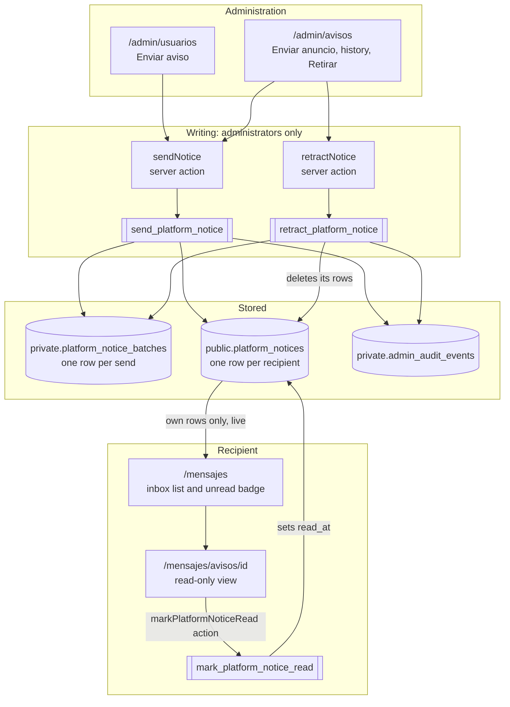
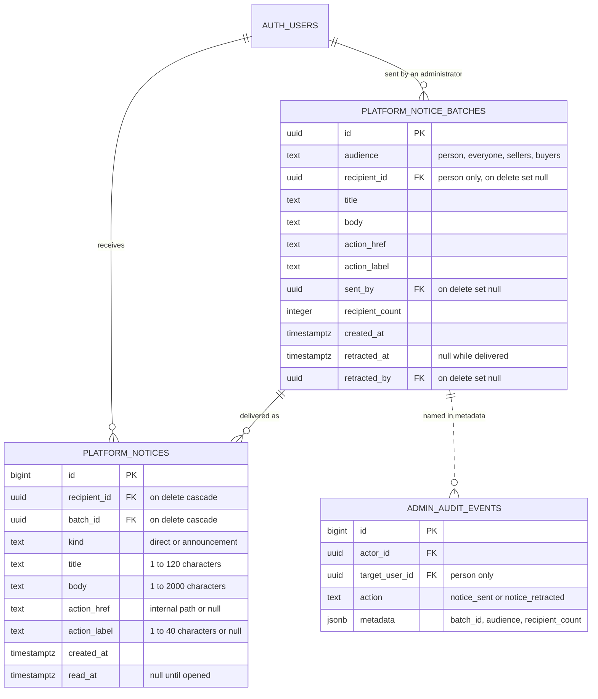
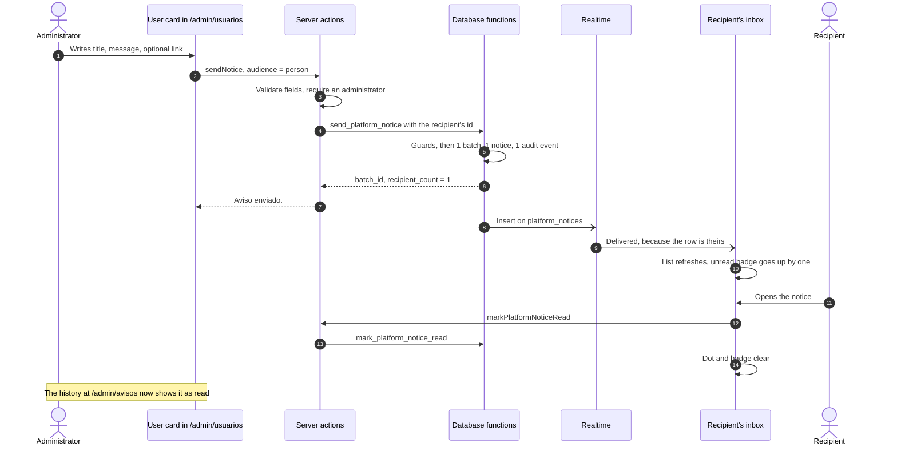
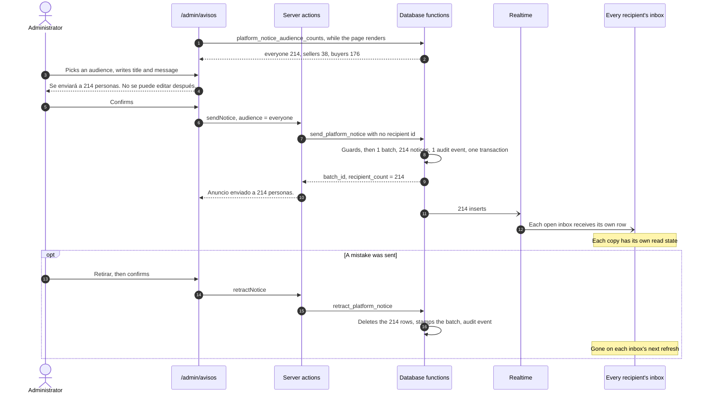
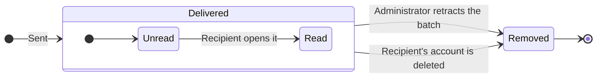
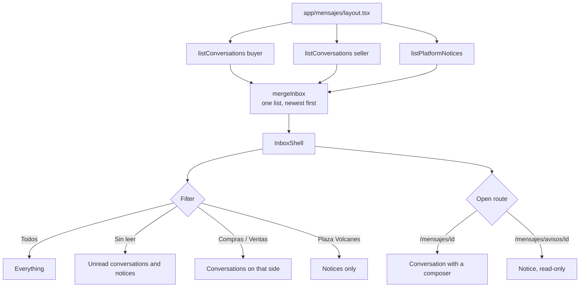

# Platform Notices — Design Specification

## Objective

Let administration write to the people who use the plaza, one person at a time or many at once, and have those messages arrive in the same inbox as buying and selling conversations, clearly marked as coming from Plaza Volcanes and not from a buyer or a seller.

## Scope

This project includes:

- A notice sent by an administrator to one person
- An announcement sent by an administrator to an audience: everyone, people who sell, or people who only buy
- A history of everything sent, with how many people have read each one
- Retracting a notice or an announcement after it was sent
- Notices in the `/mensajes` inbox: their own rows, their own filter, a read-only view, and a place in the unread badge
- Live arrival, the same way messages arrive today
- Database, action, mapper, component, route, and end-to-end tests

This project excludes:

- Replies. A notice is one-way. The read-only view points to `/quejas-y-aclaraciones` for anyone who needs to answer.
- Notices written by the system itself ("your shop was approved"). The table and the inbox are built so these are a small addition later; see "Later work".
- Email copies. The existing `private.notification_outbox` is the place for them later.
- Editing a notice after it is sent, scheduling one for later, and audiences narrower than the three above.
- Attachments, rich text, and links that leave the site.
- A product, order, or shop picture on a notice. The row always shows the Plaza Volcanes mark.

It builds on the unified inbox (`2026-10-13-unified-messages-inbox-design.md`) and ships after it.

## Terms

| Term | Meaning | Shown to people as |
| --- | --- | --- |
| Notice | One message from the plaza in one person's inbox. One row of `public.platform_notices`. | `Aviso` when it was written to them alone, `Anuncio` when it was written to an audience |
| Batch | One act of sending by an administrator: to one person or to an audience. One row of `private.platform_notice_batches`. | Not shown to recipients. A line in the history at `/admin/avisos`. |
| Audience | Who a batch goes to: `person`, `everyone`, `sellers`, `buyers`. | `Una persona`, `Todas las personas`, `Quienes venden`, `Quienes solo compran` |

## How it fits together

Notices do not reuse `public.conversations` and `public.messages`. A conversation needs a shop and a buyer, every message needs a sending account, and every message insert starts the seller's response clock, queues a seller email, and counts against a rate limit. A notice has no shop, no counterpart, and no reply, so each of those paths would need an exception, and one missed exception would bend a seller's trust metrics. Notices get their own table and meet conversations only in the inbox.



## Data model



### `public.platform_notices`

One row per recipient. An announcement to 200 people is 200 rows, each with its own `read_at`, so one person reading it changes nothing for anyone else.

- The content is copied onto every row. A row is everything a reader needs, so reading it is a single-table select under row-level security.
- `kind` is `direct` for the `person` audience and `announcement` for the others.
- `action_href` and `action_label` are both set or both null. `action_href` must be a path inside the site: it starts with a single `/` and never with `//` or `/\`.
- Deleting an account deletes its notices. They never block `admin_delete_user` the way orders and conversations do.
- Indexes: `(recipient_id, created_at desc)` for the inbox, `(recipient_id) where read_at is null` for the badge, and `(batch_id)` for retraction and read counts.

Access:

- Row-level security is on. One policy: an authenticated person may `select` rows where `recipient_id` is their own id.
- `authenticated` is granted `select` only. There is no insert, update, or delete grant: a recipient cannot write a notice, alter one, or mark one read by updating the table. Reading state changes through `mark_platform_notice_read`.
- Administrators get no table access either. They work through the functions below.
- The table is added to the `supabase_realtime` publication. The select policy scopes delivery, as it does for `public.messages`.

### `private.platform_notice_batches`

The administration's record of each send. It keeps a copy of the content so the history still says what was sent after a retraction removes the rows, and it is the only place that knows which administrator sent it. It is in the `private` schema with no grants, so a recipient can never learn who wrote a notice.

### Audit

`private.admin_audit_events.action` gains `notice_sent` and `notice_retracted`.

- `notice_sent` sets `actor_id`, sets `target_user_id` for the `person` audience, and records `batch_id`, `audience`, `recipient_count`, and `title` in `metadata`.
- `notice_retracted` sets `actor_id` and records `batch_id` and the number of rows removed.

## Audiences

| Audience | Who receives it |
| --- | --- |
| `person` | The one account named by the administrator, whatever its state |
| `everyone` | Every account that is not disabled |
| `sellers` | Every account that is not disabled and owns at least one shop, approved or not |
| `buyers` | Every account that is not disabled and owns no shop |

"Disabled" is the predicate the account controls already use: `banned_until is not null and banned_until > now()`. Administrators are people too and are included, which also lets the sender see their own announcement arrive.

An audience is evaluated once, when the batch is sent. Someone who registers afterwards does not receive it, and someone who opens a shop afterwards does not retroactively receive what was sent to sellers.

## Functions

All are `security definer` with an empty `search_path`, revoked from `public` and `anon`, and granted to `authenticated`. The administrator functions refuse a caller who is not an administrator with SQLSTATE `42501`.

| Function | Caller | Returns | Does |
| --- | --- | --- | --- |
| `send_platform_notice(p_audience, p_recipient_id, p_title, p_body, p_action_href, p_action_label)` | Administrator | `batch_id uuid, recipient_count integer` | Creates the batch, one notice per recipient, and the audit event, in one transaction |
| `retract_platform_notice(p_batch_id)` | Administrator | `integer` rows removed | Deletes the batch's notices, stamps the batch as retracted, writes the audit event |
| `platform_notice_audience_counts()` | Administrator | `audience text, people integer` for the three broadcast audiences | Lets the form say how many people an announcement will reach before it is sent |
| `list_platform_notice_batches()` | Administrator | The newest 100 batches with audience, recipient label, content, `recipient_count`, `read_count`, and `retracted_at` | Feeds the history |
| `mark_platform_notice_read(p_notice_id)` | The recipient | nothing | Sets `read_at` on the caller's own unread notice. Any other id is ignored without an error. |
| `unread_message_count()` | Anyone signed in | `integer` | Recreated with the same signature: unread messages plus unread notices |

`send_platform_notice` checks, in this order:

1. The caller is signed in and is an administrator, otherwise `42501`.
2. `p_audience` is one of the four, otherwise `22023`.
3. For `person`, `p_recipient_id` names an existing account, otherwise `P0002`. For the others, `p_recipient_id` is null, otherwise `22023`.
4. Title, body, link, and label satisfy the column rules, otherwise `22023`. The table's check constraints back this up.
5. The audience has at least one member, otherwise `P0002` with `No hay personas en esa audiencia.` and nothing is stored.

`retract_platform_notice` refuses an unknown batch with `P0002`. It is not an error when the batch was already retracted: it removes nothing, returns `0`, and writes no second audit event.

## Sending to one person



A direct notice may be sent to a disabled account. That person cannot sign in to read it, and it is waiting for them if the account is enabled again.

## Broadcasting to an audience



The fan-out is a single `insert ... select` over the audience. Either every recipient gets the announcement or, if anything fails, nobody does.

## Life of a notice



There is no way back from `Read` to `Unread`, and a recipient cannot remove a notice. Retraction removes the rows; the batch stays in the history marked `Retirado`.

## Reading: the inbox



### Data

- `listPlatformNotices()` (new, `lib/queries/platform-notices.server.ts`) selects the caller's newest 100 notices.
- `InboxEntry` becomes a union told apart by `role`: `buyer`, `seller`, or `platform`. Every entry carries `key`, `href`, `sent_at`, and `unread_count`, which is all the list needs to order, link, and count. A notice's `unread_count` is `1` or `0`. Conversation and notice ids come from different tables and can collide, so `key` is what React and the open-row check use.
- `mergeInbox(buying, selling, notices)` orders all three together by `sent_at`.
- `filterInbox` gains the `platform` filter. Search matches a notice's title and body.
- `unreadTotals` gains `platform`.

### List row

```
●  [▲]  Plaza Volcanes                     10:42 a.m.
        ANUNCIO
        Mantenimiento el sábado por la noche
        La plaza estará en pausa de 11 p.m. a 1 a.m. …   ①
```

- The picture is the Plaza Volcanes mark on the brand colour, with no buyer or seller badge. No conversation row can show it.
- The name is always `Plaza Volcanes`.
- The label is `Aviso` or `Anuncio`. The subject is the title. The preview is the start of the body.
- Unread state, date, and the open-row marker work as they do for conversations.

### Filter

A `Plaza Volcanes` filter joins `Todos`, `Sin leer`, `Compras`, and `Ventas`, with its unread total. It appears once the person has at least one notice. `Sin leer` counts unread notices too.

### Read-only view

`/mensajes/avisos/[id]`, beside the list from `lg` and on its own screen below it, with the same back link as a conversation.

```
┌──────────────────────────────────────────────────────┐
│ ←  Plaza Volcanes                                    │
│    ANUNCIO                                           │
├──────────────────────────────────────────────────────┤
│  Mantenimiento el sábado por la noche                │
│  12 de octubre · 10:42 a.m.                          │
│                                                      │
│  La plaza estará en pausa de 11 p.m. a 1 a.m.        │
│  Tus publicaciones y pedidos no cambian.             │
│                                                      │
│  [ Ver mi panel ]                                    │
│                                                      │
│  Este mensaje es de Plaza Volcanes y no admite       │
│  respuesta. ¿Necesitas ayuda? Quejas y aclaraciones  │
└──────────────────────────────────────────────────────┘
```

- `Plaza Volcanes` is the page's `h1`; the notice title is an `h2`.
- The body is plain text with its line breaks kept. Long words and links wrap. Nothing in it is turned into a link.
- The action button appears only when the notice has a link, and goes to `action_href`.
- There is no composer.
- Opening the view marks the notice read from a client effect, then refreshes the router so the row and the header badge clear. Rendering the page does not write: a render is a GET.
- A notice that does not exist, belongs to someone else, or was retracted reads as not found inside the inbox, the same way a foreign conversation does.

The shell reads the open entry from `useSelectedLayoutSegments()`, because a notice is two segments below the layout and a conversation is one.

### Staying current

`subscribeToMessageInserts` becomes `subscribeToInserts` and takes the table. The inbox shell listens to inserts on `public.messages` and on `public.platform_notices` and refreshes as it does today. Deletes are not listened to: a retracted notice leaves an open inbox on its next refresh, which also happens whenever the tab becomes visible again.

`unread_message_count()` already feeds the header and the quick-access bar, so both badges include notices with no interface change.

## Administration interface

`app/admin/layout.tsx` gains an `Avisos` link beside `Usuarios`, `Disputas`, and `Importaciones`. The site header gains nothing: its row is already full at `md`.

### One person: `/admin/usuarios`

Each user card gains `Enviar aviso`, which reveals an inline form in the card, like the delete confirmation does.

```
┌ Enviar aviso a Ana Ruiz ─────────────────────────────┐
│ Título      [ Tu tienda necesita una foto de portada ]│
│ Mensaje     [                                        ]│
│             [                                        ]│
│ Enlace      [ /panel            ]  (opcional)         │
│ Texto del botón [ Ir a mi panel ]  (con enlace)       │
│                                                       │
│ [ Enviar aviso ]  [ Cancelar ]                        │
└───────────────────────────────────────────────────────┘
```

Unlike the account controls, the form is offered on administrator accounts too: writing to a colleague is harmless.

### An audience and the history: `/admin/avisos`

```
Administración
Avisos y anuncios

┌ Nuevo anuncio ───────────────────────────────────────┐
│ Para        ( ) Todas las personas        214        │
│             ( ) Quienes venden             38        │
│             ( ) Quienes solo compran      176        │
│ Título      [                                      ] │
│ Mensaje     [                                      ] │
│ Enlace      [            ]   Texto del botón [     ] │
│                                                      │
│ [ Enviar anuncio ]                                   │
│                                                      │
│   Se enviará a 214 personas. No se puede editar      │
│   después; solo retirar.                             │
│   [ Enviar a 214 personas ]  [ Cancelar ]            │
└──────────────────────────────────────────────────────┘

Enviados
┌──────────────────────────────────────────────────────┐
│ Mantenimiento el sábado por la noche      12 oct     │
│ Todas las personas · 214 enviados · 131 leídos       │
│                                          [ Retirar ] │
├──────────────────────────────────────────────────────┤
│ Tu tienda necesita una foto de portada    11 oct     │
│ Ana Ruiz · Leído                         [ Retirar ] │
├──────────────────────────────────────────────────────┤
│ Nuevas categorías                          3 oct     │
│ Quienes venden · Retirado el 3 oct                   │
└──────────────────────────────────────────────────────┘
```

- The three counts come from `platform_notice_audience_counts()` when the page renders.
- `Enviar anuncio` does not send. It reveals the confirmation with the count for the chosen audience; the second button sends. No browser dialog is used.
- `Retirar` also asks for confirmation inline.
- The history shows the newest 100 batches, direct notices included. A direct notice shows the recipient's name and `Leído` or `Sin leer`. A recipient whose account was deleted shows as `Cuenta eliminada`.

## Server actions

`lib/actions/platform-notices.ts` exports `sendNotice` and `retractNotice`, both `(previousState, formData) => Promise<ActionState>` and both following `lib/actions/admin-users.ts`: validate the form, require a claim subject, require `is_current_user_admin`, call the function, revalidate, and never echo a database error message. It also exports `markPlatformNoticeRead(noticeId)`, which never throws: read state is a convenience.

`lib/validation/platform-notice.ts` holds the field rules: title 1 to 120 characters, body 1 to 2000, link empty or an internal path of at most 300 characters, button text required with a link and at most 40 characters.

| Case | `sendNotice` | `retractNotice` |
| --- | --- | --- |
| Malformed input | The field's own message, for example `Escribe un título.` or `El enlace debe empezar con / y quedarse dentro de la plaza.` | `Datos de aviso inválidos.` |
| No session | `Tu sesión terminó. Ingresa nuevamente.` | same |
| Not an administrator | `No tienes permiso para enviar avisos.` | same |
| `P0002`, person | `No encontramos esa cuenta.` | — |
| `P0002`, audience | `No hay personas en esa audiencia.` | `No encontramos ese envío.` |
| Other failure | `No pudimos enviar el aviso.` | `No pudimos retirar el aviso.` |
| Success | `Aviso enviado.` or `Anuncio enviado a 214 personas.` | `Aviso retirado.` |

`sendNotice` and `retractNotice` revalidate `/admin/avisos` and the `/mensajes` layout.

## Security

- **The sender cannot be imitated from a conversation.** The mark, the `Plaza Volcanes` name, and the `Aviso` and `Anuncio` labels are drawn only for rows of `public.platform_notices`, and nobody but the administrator functions can write there.
- **Links stay inside the site.** `action_href` is checked by the form, by the function, and by a table constraint. Text in a body is never made clickable.
- **Content is plain text**, rendered by React as text.
- **Recipients see only their own notices** and cannot change them.
- **The administrator's identity stays private.** It exists only in the `private` batch table and the audit trail.
- **Every send and every retraction is audited.**

Related risk, not addressed here: a conversation row shows the shop's name, and nothing stops a seller from naming a shop `Plaza Volcanes` or `Soporte Plaza Volcanes`. The mark and labels above make a real notice recognisable, but reserving those names in shop validation would close the gap from the other side. It is a separate, small change.

## Limits

- **No editing.** The fix for a mistake is to retract and send again.
- **Live delivery at size.** Each inserted row is checked against every open inbox's subscription. That is unnoticeable for hundreds or a few thousand accounts. Before an audience reaches about ten thousand, announcements should stop relying on per-row live delivery and appear on the next refresh instead.
- **Storage.** An announcement's text is copied per recipient: at most about 2 kB each.
- **The inbox shows a person's newest 100 notices.** Older ones stay in the table.
- **No retention rule yet.** Notices are kept until retracted or the account is deleted.

## Later work

Each of these fits the design without changing it:

- **System notices.** A `private.notify(recipient, kind, title, body, href, label)` helper inserts a row directly. `batch_id` becomes nullable and `kind` gains values such as `shop_approved`, `listing_disabled`, and `dispute_resolved`. Each event is then one call inside the function that already handles it.
- **Email.** `private.notification_outbox.kind` gains `platform_notice`, queued on insert and sent by the existing Edge Function, honouring `notification_preferences`.
- **Context pictures.** Optional `order_id`, `shop_id`, and `product_id` on a notice, once system notices exist to use them.
- **Retention**, for example removing read announcements after a year.

## Rollout

1. The unified inbox ships first.
2. The migration is applied before the interface. It is additive: `unread_message_count()` keeps its signature and returns the same number for anyone without notices.
3. The interface follows. Until an administrator sends something, nobody sees a difference.

## Testing

### Database (`supabase/tests/database/platform_notices.test.sql`)

- The functions exist; anonymous and non-administrator callers are refused with `42501`
- An unknown audience, a recipient with a broadcast audience, and a missing recipient for `person` are refused; an unknown recipient is `P0002`
- A link outside the site is refused by the function and by the table
- `person` creates one batch, one notice of kind `direct`, and `notice_sent` with the target
- `everyone`, `sellers`, and `buyers` each reach exactly their members, as `announcement`; disabled accounts are skipped; an empty audience is `P0002` and stores nothing
- A recipient reads their own notices and nobody else's; they cannot insert, update, or delete
- `mark_platform_notice_read` marks the caller's own notice and ignores another person's
- `unread_message_count` counts unread notices and stops counting them once read
- `platform_notice_audience_counts` matches the fan-out
- `list_platform_notice_batches` reports `recipient_count` and `read_count`
- Retracting removes the rows, stamps the batch, writes `notice_retracted`, and is a no-op the second time
- Deleting a recipient removes their notices and leaves the batch

### Unit (Vitest)

- Field validation: lengths, the link rule (`/panel` accepted; `//evil.test`, `https://evil.test`, `/\evil` refused), button text required with a link
- `mergeInbox` orders notices among conversations; keys never collide
- `filterInbox`: the `platform` filter, `Sin leer` including notices, search by title and body
- `unreadTotals` with notices
- Each action: malformed input short-circuits, missing claim, non-administrator, exact function arguments, coded errors map to their messages without leaking database text, success revalidates

### Component (Vitest)

- `InboxShell`: a notice row with the mark, name, label, title, and preview; the `Plaza Volcanes` filter appears only with notices; the open notice is marked current and shown as read; a conversation and a notice with the same id are told apart
- Notice view: heading, title, body with line breaks, action button only with a link, no composer, marks read once
- User card form: reveals, submits the person audience, cancels
- `/admin/avisos`: counts beside each audience, confirmation shows the chosen count, history rows for an announcement, a direct notice, and a retracted batch

### End to end (`tests/e2e/platform-notices.spec.ts`)

Against the local stack and through the real interface: an administrator sends a notice to one person; that person sees an unread `Plaza Volcanes` row and badge, opens it, finds no way to reply, and the badge clears; the administrator sees it as read, broadcasts to everyone, and both accounts receive it; the administrator retracts it and it is gone from the other inbox.

### Verification gates

Focused Vitest files, `supabase test db`, `npm run typecheck`, `npm run lint`, full `npm test`, the new end-to-end spec together with the messaging and mobile-polish specs, and a production build that still links one global stylesheet from `/`.
